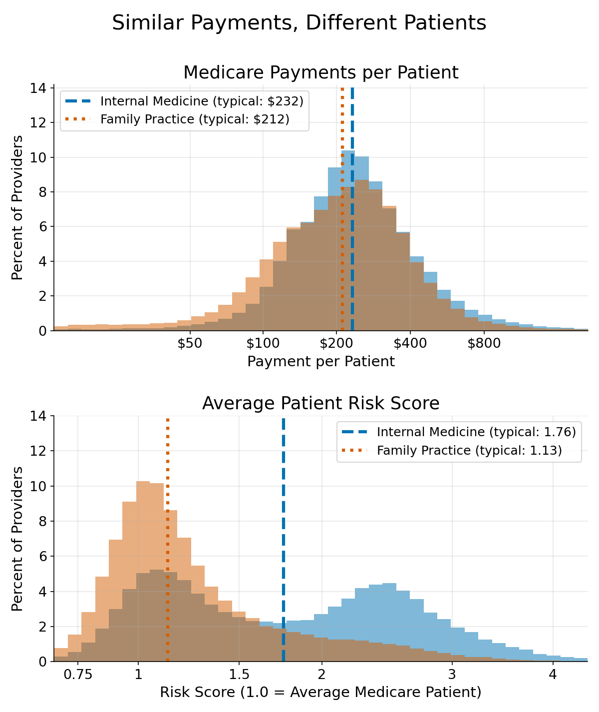

<h1>Detecting Unusual Medicare Provider Billing Patterns</h1>

<h2>Tools and Libraries</h2>
<ul>
  <li>Python</li>
  <li>pandas and NumPy</li>
  <li>Matplotlib and Seaborn</li>
  <li>scikit-learn</li>
  <li>TensorFlow/Keras</li>
  <li>Jupyter Notebook</li>
</ul>

<h2>Overview</h2>

  This project examines unusual Medicare billing patterns among
  177,266 individual providers in Internal Medicine and Family
  Practice. Using 2024 data from the Centers for Medicare &amp;
  Medicaid Services (CMS), the analysis compares traditional
  statistical outlier detection (Z-score) with TensorFlow
  autoencoders to identify providers whose billing differs
  from their specialty peers.

  The goal is to help analysts prioritize unusual billing patterns
  for further review. Being flagged does not establish fraud,
  improper billing, or misconduct.

<h2>Problem</h2>

  Medicare processes an enormous volume of provider billing
  information, making individual review of every provider
  impractical. High payments or unusually large service volumes
  do not necessarily indicate improper billing, particularly
  when providers treat different patient populations or bill
  for services measured in different units.

This analysis addresses four research questions:

<ol>
  <li>
    How do service volumes, charges, and payments vary within
    and between Internal Medicine and Family Practice?
  </li>
  <li>
    Which billing indicators show the greatest variation
    among specialty peers?
  </li>
  <li>
    Which providers are flagged by the autoencoders, and how
    closely do they match statistical outliers?
  </li>
  <li>
    How could the findings help analysts prioritize providers
    for review?
  </li>
</ol>

<h2>Data</h2>

  The dataset contains individual provider billing records
  from the 2024 Medicare Physician &amp; Other Practitioners dataset.

<ul>
  <li><strong>Records:</strong> 177,266 individual providers</li>
  <li><strong>Original variables:</strong> 81 columns</li>
  <li><strong>Internal Medicine:</strong> 93,627 providers</li>
  <li><strong>Family Practice:</strong> 83,639 providers</li>
  <li><strong>Selected variables:</strong> 10</li>
  <li><strong>Duplicate provider records:</strong> None</li>
  <li>
    <strong>Missing values:</strong>
    None in the 10 selected variables
  </li>
</ul>

  The analysis examines provider specialty, state, beneficiary
  counts, service volumes, procedure codes, submitted charges,
  allowed amounts, Medicare payments, and average patient risk scores.

Three additional billing indicators were calculated:

<ul>
  <li>
    <strong>Services per beneficiary:</strong>
    Total services divided by beneficiaries
  </li>
  <li>
    <strong>Payments per beneficiary:</strong>
    Medicare payments divided by beneficiaries
  </li>
  <li>
    <strong>Charge-to-allowed ratio:</strong>
    Submitted charges divided by Medicare allowed amounts
  </li>
</ul>

  These indicators allow providers of different sizes to be
  compared more meaningfully within their own specialties.
  Patient risk scores provide additional context about
  patient complexity.

  One Family Practice provider with zero Medicare payments
  was kept, and extreme records were reviewed but not removed.
  The most extreme service volumes reflected drug billing
  units rather than individual patient visits.

<h2>Data Source</h2>

  <strong>Dataset:</strong>
  Medicare Physician &amp; Other Practitioners – by Provider, 2024

  <strong>Publisher:</strong>
  Centers for Medicare &amp; Medicaid Services (CMS)

  <strong>Source:</strong>
  <a href="https://data.cms.gov/provider-summary-by-type-of-service/medicare-physician-other-practitioners/medicare-physician-other-practitioners-by-provider">
    CMS Medicare Physician &amp; Other Practitioners Data
  </a>

  <strong>Data dictionary:</strong>
  <a href="https://data.cms.gov/resources/medicare-physician-other-practitioners-by-provider-data-dictionary">
    CMS Provider Data Dictionary
  </a>

  <strong>Filter applied:</strong>
  Provider Type contains "internal medicine" OR "family practice"

  <strong>Retrieved:</strong> November 11, 2026

  The publicly available CMS dataset was filtered to providers
  in Internal Medicine and Family Practice. The filtered dataset
  is included in the repository as a compressed CSV archive.

<h2>Methodology</h2>
<ol>
  <li>
    <strong>Data inspection:</strong>
    Examined dataset dimensions, missing values, duplicate
    providers, and unusual billing records.
  </li>
  <li>
    <strong>Feature engineering:</strong>
    Calculated services per beneficiary, payments per beneficiary,
    and charge-to-allowed ratios.
  </li>
  <li>
    <strong>Data transformation:</strong>
    Applied logarithmic transformations to reduce the
    influence of extreme values.
  </li>
  <li>
    <strong>Exploratory analysis:</strong>
    Compared billing distributions, patient risk scores,
    and correlations between variables.
  </li>
  <li>
    <strong>Statistical baseline (Z-score):</strong>
    Calculated Z-scores within each specialty and identified
    providers exceeding three standard deviations on any
    billing indicator.
  </li>
  <li>
    <strong>Neural network modeling:</strong>
    Trained a separate TensorFlow autoencoder for each
    specialty using three billing indicators and patient
    risk scores.
  </li>
  <li>
    <strong>Model comparison:</strong>
    Flagged the top 1% of providers by autoencoder
    reconstruction error and compared those results
    with statistical outliers.
  </li>
  <li>
    <strong>Interpretation:</strong>
    Examined which billing indicators contributed most
    to unusual patterns.
  </li>
</ol>

  Each autoencoder used an 80/20 training and validation split,
  with early stopping to limit overfitting.

<h2>Key Findings</h2>
<ul>
  <li>
    <strong>Similar payments, different patient populations:</strong>
    The 42% gap in median total Medicare payments between
    specialties narrowed to approximately 10% when measured
    per beneficiary. Median payments were $232 for Internal
    Medicine and $212 for Family Practice.
  </li>
  <li>
    <strong>Patient complexity differed most:</strong>
    Median risk scores were 1.76 for Internal Medicine
    and 1.13 for Family Practice.
  </li>
  <li>
    <strong>Services varied most among peers:</strong>
    Services per beneficiary showed the greatest typical
    variation in both specialties. Some extreme service
    volumes reflected drug billing units rather than
    individual patient encounters.
  </li>
  <li>
    <strong>The models performed similarly:</strong>
    Both autoencoders achieved validation errors of 0.1152
    and 0.1157, with training and validation error closely aligned.
  </li>
  <li>
    <strong>Autoencoders identified 1,774 providers:</strong>
    The models flagged 937 Internal Medicine and 837 Family
    Practice providers, representing the highest 1% of
    reconstruction errors within each specialty.
  </li>
  <li>
    <strong>The methods identified different patterns:</strong>
    Among autoencoder flags, 379 Internal Medicine and
    457 Family Practice providers did not exceed the
    statistical outlier threshold on any individual
    billing indicator.
  </li>
  <li>
    <strong>Financial indicators contributed most:</strong>
    Payments per beneficiary and charge-to-allowed ratios
    together accounted for approximately 79% of reconstruction
    error among flagged Internal Medicine providers and
    77% among flagged Family Practice providers.
  </li>
</ul>

<h2>Conclusion</h2>

  Comparing Medicare providers within specialties and measuring
  billing per beneficiary revealed that typical payment patterns
  were more similar than total payments initially suggested.
  Patient complexity showed a clearer distinction between
  Internal Medicine and Family Practice.

  The two detection methods provided complementary findings.
  Statistical Z-scores identified providers with extreme
  individual billing indicators, while TensorFlow autoencoders
  also identified unusual combinations of values that did
  not exceed those thresholds.

  Payments per beneficiary and charge-to-allowed ratios
  emerged as useful starting points for reviewing unusual
  billing. The results support using automated methods to
  narrow the number of records requiring human examination,
  not to make determinations of fraud or improper billing.

<h2>Recommendations</h2>
<ul>
  <li>
    Compare providers within their own specialty and on a
    per-beneficiary basis rather than by total payments.
  </li>
  <li>
    Begin each review with payments per beneficiary and
    the charge-to-allowed ratio.
  </li>
  <li>
    Give highest priority to providers flagged by both methods,
    while also examining those flagged by only one.
  </li>
  <li>
    Use flags to guide review priorities, not to trigger
    enforcement actions automatically.
  </li>
  <li>
    Pilot the approach on a small set of reviews before
    applying it more widely.
  </li>
</ul>

<h2>Visualizations</h2>

The notebook includes six visualizations:

<ol>
  <li>Billing Indicator Histograms by Specialty</li>
  <li>Billing Indicator and Risk Score Heatmap</li>
  <li>Billing Variation and Z-Score Outlier Table</li>
  <li>Autoencoder Training and Validation Loss</li>
  <li>Autoencoder and Z-Score Flag Comparison Scatter Plot</li>
  <li>Model Input Contributions to Autoencoder Flags</li>
</ol>

  Each visualization includes an assessment explaining
  its findings.

<h3>Featured Visualization</h3>

<strong>Similar Payments, Different Patients</strong>

  

  The upper chart shows substantial overlap in Medicare payments
  per beneficiary between the two specialties. The lower chart
  reveals a much larger difference in patient risk scores,
  with Internal Medicine providers generally serving
  higher-risk patients.

<h2>How to Run</h2>
<ol>
  <li>
    Download the notebook and zipped dataset from this folder.
  </li>
  <li>
    Unzip the dataset into the same directory as the notebook.
  </li>
  <li>
    Open <code>Medicare_Billing.ipynb</code> in Jupyter Notebook
    or JupyterLab.
  </li>
  <li>
    Install the listed Python libraries if necessary.
  </li>
  <li>
    Run all cells in sequence. Fixed random seeds (42) and
    deterministic operations reproduce the reported results.
  </li>
</ol>

<h2>Repository Structure</h2>
<ul>
  <li>
    <code>Medicare_Billing.ipynb</code> —
    Analysis, modeling, visualizations, and findings
  </li>
  <li>
    <code>Medicare_PHysician_Other_Practitioner_by_Provider_2024.zip</code>
    — Filtered 2024 CMS dataset (unzip before running)
  </li>
  <li>
    <code>README.md</code> — Project documentation
  </li>
</ul>

<h2>Ethical Considerations</h2>

  Unusual billing patterns do not establish fraud. Flags should
  be treated as review priorities, not evidence of misconduct,
  and human review is required before any action. Comparing
  specialty peers and considering patient complexity helps
  reduce unfair scrutiny of providers who treat sicker patients.
  This project does not identify individual flagged providers.

<h2>Limitations</h2>

  The data covers a single year and excludes providers with
  fewer than 11 Medicare beneficiaries. The analysis did not
  adjust for geographic differences, practice settings, or
  specific services performed. Service counts can reflect drug
  billing units rather than patient encounters. Without
  confirmed fraud labels, fraud-detection accuracy cannot
  be measured.

