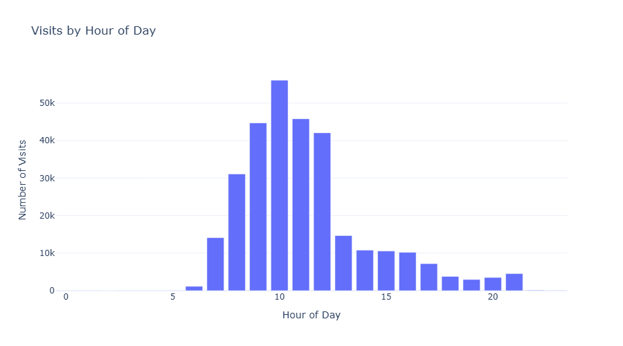
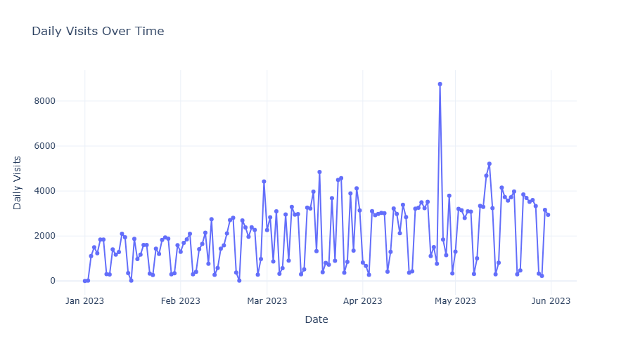
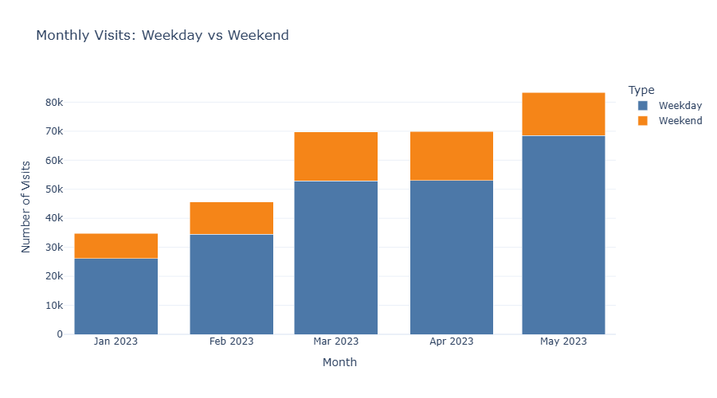
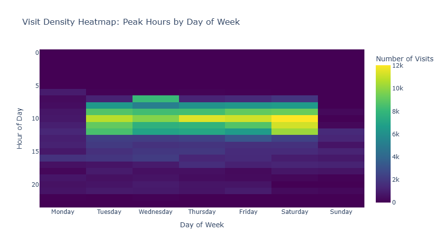
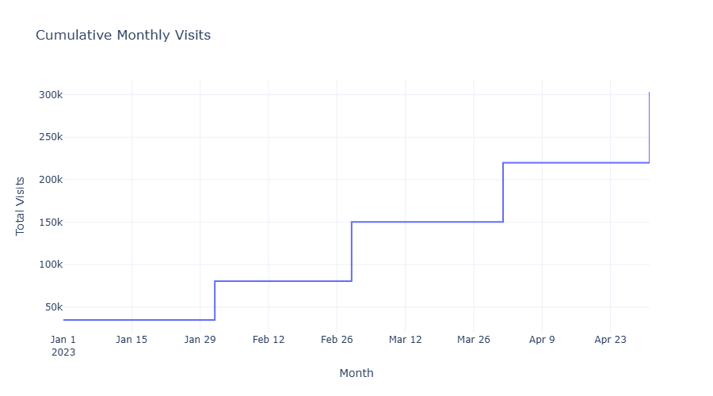
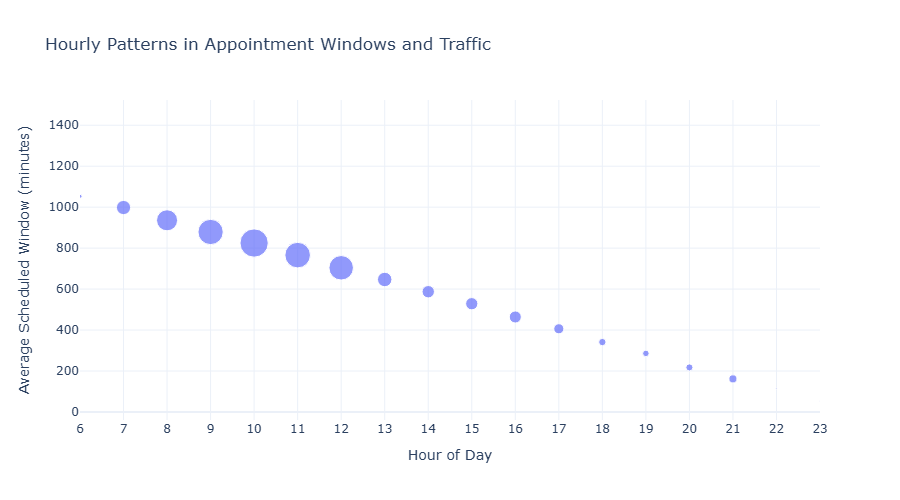

# White House Visitor Traffic Analysis

**Tools:** Python, pandas, NumPy, Matplotlib, Seaborn, Plotly, Kaleido, Jupyter Notebook

## Overview

This project analyzes 303,374 White House visitor records from January through May 2023 to identify patterns in scheduled visitor activity and explore their implications for staffing and operations. The analysis uses six interactive visualizations to examine scheduling trends by hour, day, and month.

## Objective

Identify periods of higher and lower scheduled visitor activity and evaluate how these patterns could support staffing, scheduling, and resource allocation decisions.

## Data

The analysis uses five monthly White House visitor record datasets covering January through May 2023.

- `2023.01_WH-VISITOR-RECORDS.csv`
- `2023.02_WH-VISITOR-RECORDS.csv`
- `2023.03_WH-VISITOR-RECORDS.csv`
- `2023.04_WH-VISITOR-RECORDS.csv`
- `2023.05_WH-VISITOR-RECORDS.csv`

The records include appointment dates, scheduled start and end times, and visitor-related information.

**Data limitation:** Scheduled appointment records do not establish actual arrival times, attendance, or time spent on site. Findings should therefore be interpreted as scheduling patterns rather than confirmed visitor traffic.

## Data Sources

Source: [White House Visitor Logs (archived)](https://web.archive.org/web/20250120073615/https://www.whitehouse.gov/disclosures/visitor-logs/)

The original files were published at whitehouse.gov/disclosures/visitor-logs and are no longer available on the live site. The archived page preserves the original release.

Column descriptions: [Analysis of White House Visitor Records (Watchdog Lab)](https://watchdoglab.substack.com/p/analysis-of-white-house-visitor-records)

## Methodology

- Loaded and combined five monthly datasets.
- Standardized date and time fields.
- Created features for appointment hour, date, weekday, month, and scheduled appointment duration.
- Examined hourly, daily, weekday, weekend, and cumulative monthly patterns.
- Developed six interactive Plotly visualizations with accompanying interpretations.
- Evaluated how observed patterns could inform operational planning.

## Visualizations

1. **Bar Chart:** Scheduled appointments by hour of day.
2. **Line Chart:** Daily appointment volumes over time.
3. **Stacked Bar Chart:** Monthly weekday and weekend appointments.
4. **Heatmap:** Appointment activity by hour and day of week.
5. **Step Chart:** Cumulative monthly appointments.
6. **Bubble Chart:** Average scheduled appointment windows and appointment volumes by hour.

GitHub does not display interactive Plotly charts in notebooks, so the static versions are shown below.

## Key Findings

- Approximately 59% of scheduled appointments began between 8 AM and noon, with 10 AM representing the busiest starting hour.
- Saturday had the highest daily average, approximately 2,872 scheduled appointments.
- The busiest hour-and-day combination was Saturday at 10 AM, with approximately 12,050 scheduled appointments across the five months.
- Sunday and Monday generally showed lighter scheduling activity.
- Monthly scheduled appointment volumes increased from January through May 2023.
- Scheduled appointment windows should not be interpreted as actual time spent on site.

## Ethical Considerations

The visitor records are publicly released and include personal information about visitors and the people they visited. The notebook excludes visitor and visitee names from its initial data preview, while the visualizations focus on aggregated counts by hour, day, and month. The analysis does not investigate individual visitors, visitees, or meetings.

## Practical Application

The findings suggest prioritizing staffing and operational resources during busier morning periods, particularly Tuesday through Saturday.

Scheduling adjustments should also consider security requirements, special events, confirmed arrivals, and other operational factors not captured in these datasets.

The analysis demonstrates how historical appointment records can help identify scheduling patterns while recognizing the limitations of the available information.

## How to Run

1. Download `White_House_Visitors.ipynb` and all five CSV datasets.
2. Keep the notebook and CSV files in the same folder.
3. Open the notebook in Jupyter Notebook or JupyterLab.
4. Install the required Python packages if necessary:

   `pip install pandas numpy matplotlib seaborn plotly kaleido`

5. Restart the kernel and run all cells in order.

The notebook creates an `outputs_plotly` folder for generated charts. It saves PNG images and interactive HTML visualizations in that folder. Kaleido version 1.0 and later requires Google Chrome to save the PNG images.

## Repository Structure

The `white-house-visitors` project folder contains:

- `README.md` — Project documentation
- `White_House_Visitors.ipynb` — Complete analysis notebook
- Five monthly CSV datasets — Source data for the analysis
- `outputs_plotly` — Static (PNG) and interactive (HTML) versions of the six visualizations

## Limitations

This analysis covers only January through May 2023. Patterns observed during these months should not be assumed to continue throughout the year.

The records describe scheduled appointments rather than actual arrivals. They do not independently establish waiting times, staffing levels, or operational capacity. Recommendations should be evaluated alongside additional operational information.
